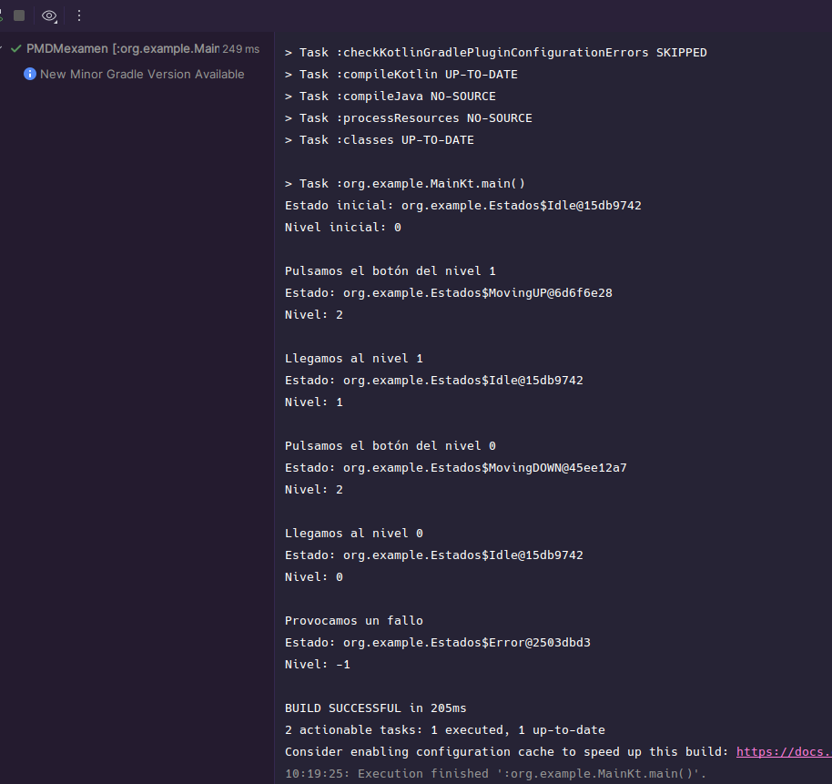
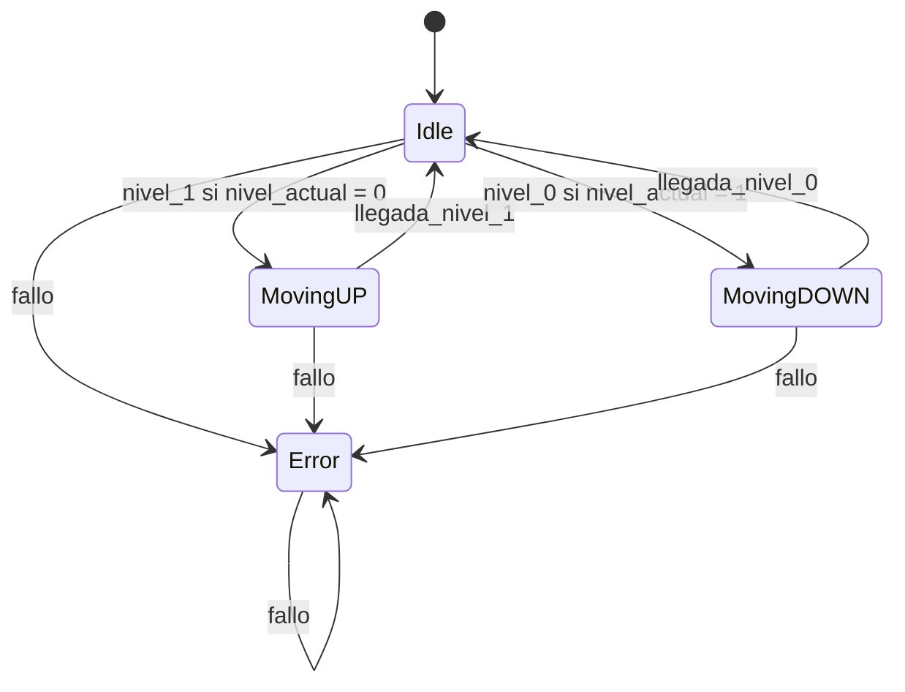
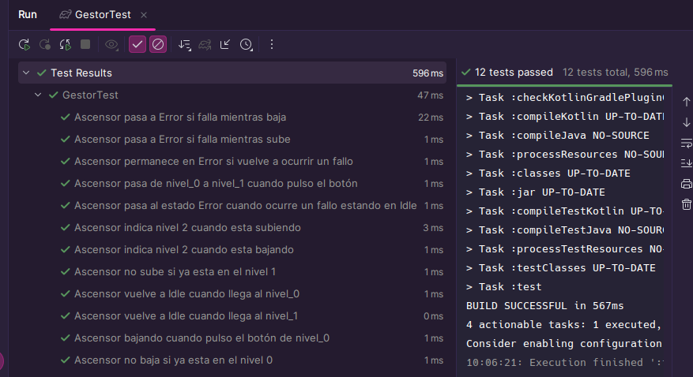

# Implementación y funcionamiento de la máquina de estados

## 1. Implementación
### Estados.kt

En este archivo se define la clase sellada `Estados`, que contiene los cuatro estados posibles del ascensor:

- **Idle:** el ascensor está parado en uno de los dos niveles.
- **MovingUP:** el ascensor está subiendo al nivel 1.
- **MovingDOWN:** el ascensor está bajando al nivel 0.
- **Error:** el ascensor se encuentra en estado de error.

Cada estado tiene métodos que representan los posibles movimientos del ascensor. Estos métodos modifican el estado actual y, cuando corresponde, el nivel del ascensor.nsor.

Por ejemplo, cuando el ascensor está en `Idle` y se pulsa el botón `nivel_1`, pasa a `MovingUP` si se encuentra en el nivel 0. Cuando llega al nivel 1, vuelve a `Idle`.

### Gestor.kt

Este archivo contiene las variables que guardan el estado y el nivel actuales:

- `nivel_actual`: indica el nivel en el que se encuentra el ascensor.
- `estado_actual`: guarda el estado actual del ascensor.

La función `gestor()` devuelve un valor según el estado del ascensor:

| Valor devuelto | Significado |
|---:|---|
| `0` | El ascensor está en el nivel 0. |
| `1` | El ascensor está en el nivel 1. |
| `2` | El ascensor está en movimiento. |
| `-1` | El ascensor se encuentra en estado de error. |

### Main.kt

Este archivo permite ejecutar una simulación manual para comprobar el funcionamiento de la máquina de estados.

La simulación permite comprobar el recorrido entre los dos niveles y el cambio al estado de error.

## 2. Funcionamiento de la máquina de estados

El ascensor tiene dos niveles:

- **Nivel 0** 
- **Nivel 1**

Además, utiliza los valores `2` para indicar que está en movimiento y `-1` para indicar que se ha producido un error.

Las transiciones dependen del estado actual y del evento recibido:

| Estado actual | Evento | Estado siguiente |
|---|---|---|
| `Idle` | `nivel_1` | `MovingUP` |
| `MovingUP` | Llegada al nivel 1 | `Idle` |
| `Idle` | `nivel_0` | `MovingDOWN` |
| `MovingDOWN` | Llegada al nivel 0 | `Idle` |
| `Idle` | `fallo` | `Error` |
| `MovingUP` | `fallo` | `Error` |
| `MovingDOWN` | `fallo` | `Error` |
| `Error` | `fallo` | — | `Error` |

Si se pulsa el botón del nivel en el que ya se encuentra el ascensor, no se produce ningún cambio de estado. Si ocurre un fallo mientras está parado, subiendo o bajando, pasa a `Error`.

Cuando el ascensor llega a su destino, se actualiza `nivel_actual` al nivel correspondiente y el estado vuelve a `Idle`.

## 3. Diagrama de estados

## 4. Test realizados

Para comprobar el funcionamiento de la máquina se han creado 12 test.

Los test verifican que:

- El ascensor pasa de `Idle` a `MovingUP` al solicitar el nivel 1 desde el nivel 0.
- El ascensor vuelve a `Idle` cuando llega al nivel 1.
- El ascensor pasa de `Idle` a `MovingDOWN` al solicitar el nivel 0 desde el nivel 1.
- El ascensor vuelve a `Idle` cuando llega al nivel 0.
- El ascensor no inicia un movimiento si ya está en el nivel solicitado.
- El ascensor pasa a `Error` si ocurre un fallo durante el movimiento o mientras está parado.
- El estado `Error` se mantiene cuando vuelve a producirse un fallo.
- La función `gestor()` devuelve `2` durante el movimiento.

La ejecución de los tests terminó correctamente con el resultado `BUILD SUCCESSFUL`.

